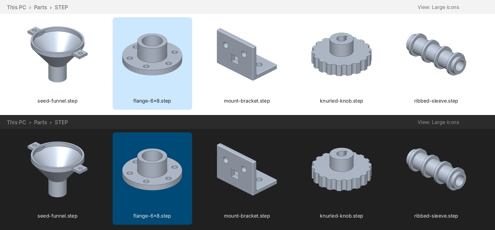

# A3D STEP Thumbnails

**See your STEP files in Windows Explorer — not a wall of identical icons.**

A3D STEP Thumbnails is a small, free shell extension for Windows 10/11 (x64) that adds
thumbnail previews for **`.step` / `.stp`** CAD files. Each part is shown in an isometric
view with clean edge lines on a transparent background, so it looks right in both light
and dark mode.



## Features

- **Thumbnails for `.step` and `.stp`** in every Explorer view: medium, large and extra large icons, tiles and content view.
- **No CAD software needed.** Files are read by the open-source [Open CASCADE](https://dev.opencascade.org) kernel.
- **Works alongside SolidWorks, Fusion and eDrawings.** If another program already had a STEP thumbnail handler, the installer keeps it and restores it when you uninstall.
- **Safe for Explorer.** Rendering runs in a separate process with a 45-second limit, so a huge or broken file can never freeze or crash Explorer.
- **No GPU required.** The renderer is pure software, so it works on any PC, over Remote Desktop and in virtual machines.
- **Fast.** Typical parts take 0.5–3 s. Very large assemblies (10+ MB) take up to about 7 s. Windows caches every thumbnail, so each file is rendered only once.
- **Smart orientation.** Files exported from SolidWorks, Creo or Inventor are treated as Y-up; other files as Z-up.

## Installation

1. Download `A3D-STEP-Thumbnails-<version>-setup.exe` from the [**Releases**](../../releases/latest) page.
2. Run it. Administrator rights are required.
3. Open a folder with STEP files and switch to **View → Large icons**.

> **Windows SmartScreen.** The installer is not code-signed yet, so Windows may show
> *"Windows protected your PC"*. Click **More info → Run anyway**.

### Thumbnails don't appear?

Windows may still be showing old cached icons. To fix this:

1. Open **Disk Cleanup**, select drive **C:**, tick **Thumbnails** and click **OK**.
2. Restart Explorer: **Task Manager → Windows Explorer → Restart**.

### Uninstall

Go to **Settings → Apps → Installed apps → A3D STEP Thumbnails → Uninstall**.

## How it works

| Component | Role |
| --- | --- |
| `stepthumb.dll` | A tiny COM thumbnail handler (`IThumbnailProvider`) that Windows loads. It contains no CAD code. |
| `stepthumb-render.exe` | The renderer. It reads STEP with Open CASCADE 7.7.2, tessellates the shapes and draws them with a software rasterizer: anti-aliasing, edge lines and silhouette outlines. |

For each file, the DLL streams the STEP data to the renderer over a pipe and gets a 32-bit
image back. The renderer runs at below-normal priority inside a Windows job object, so it is
always cleaned up together with its host process.

You can also run the renderer by hand to check a file:

```
"C:\Program Files\A3D\STEP Thumbnails\stepthumb-render.exe" part.step preview.tga 512
```

## Building from source

The whole project is cross-compiled on Linux (Ubuntu 24.04) with MinGW-w64:

```bash
sudo apt install mingw-w64 cmake ninja-build nsis git
bash build.sh
```

The first build compiles a minimal static Open CASCADE (about 30 minutes). Later builds
reuse it.

GitHub Actions builds the project on every push. It installs the result on a real Windows
machine, checks that thumbnails are generated and uploads the installer as a build artifact.
Pushing a tag like `v1.2.3` publishes a release automatically. The version number lives in
the `VERSION` file.

## Contributing

Bug reports are welcome. If a STEP file renders wrong or not at all, please
[open an issue](../../issues/new/choose). If you can, attach the file or a simplified version
of it.

## License

- A3D STEP Thumbnails: [MIT License](LICENSE).
- The renderer is statically linked with [Open CASCADE Technology](https://dev.opencascade.org),
  licensed under LGPL 2.1 with the Open CASCADE exception. Its full source and the exact build
  script are in this repository, so you can rebuild the renderer against any compatible OCCT
  version.

---

Made by **[A3D (AlexPrint3D)](https://alexprint3d.com.ua/)**, Rivne, Ukraine — 3D printing, 3D modeling and 3D scanning.
